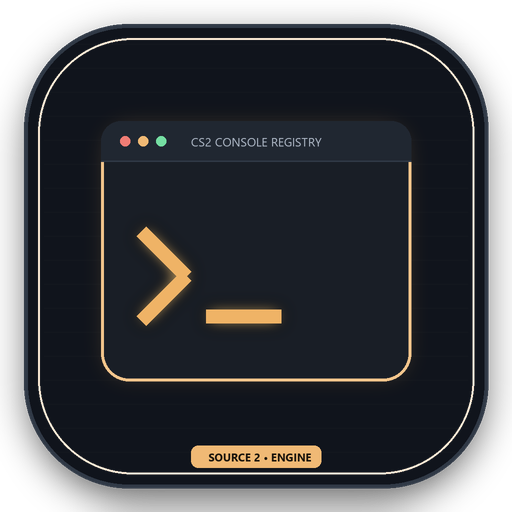
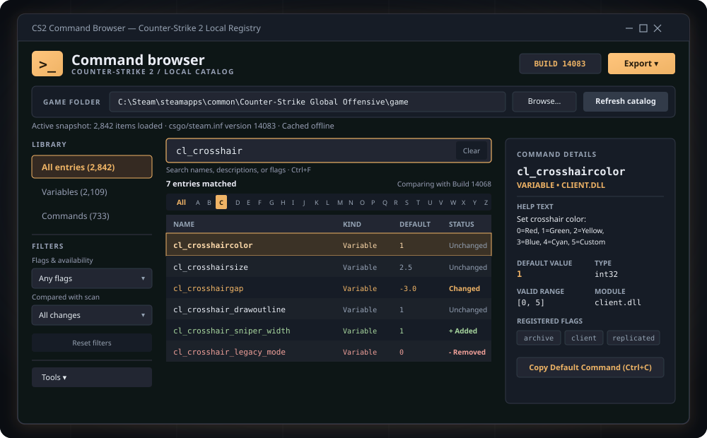
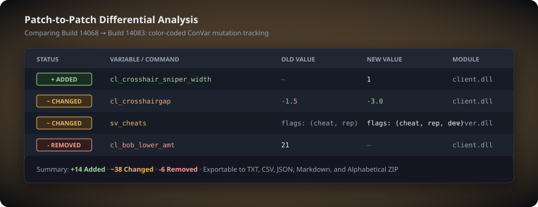
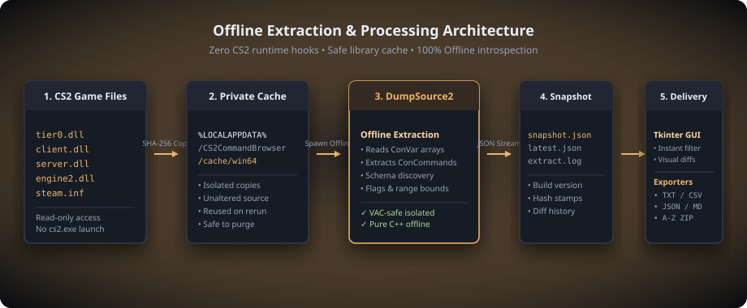

<div align="center">



# CS2 Command Browser

**A fast, offline console variable & command catalog browser for Counter-Strike 2**

*Inspect, search, diff, and export engine commands and cvars directly from your local game files — no CS2 launch or online database required.*

<p>
  <a href="LICENSE"></a>
  
  
  
  
  
  
  
</p>

---

<p>
  <a href="#-about-cs2-command-browser">About</a> •
  <a href="#-key-features">Features</a> •
  <a href="#-visual-tour">Visual Tour</a> •
  <a href="#-how-it-works">How It Works</a> •
  <a href="#-quick-start--usage">Usage</a> •
  <a href="#-data--storage-architecture">Storage</a> •
  <a href="#-building-from-source">Building</a> •
  <a href="#-icon--design-philosophy">Design</a> •
  <a href="#-upstream--license">License</a>
</p>

<picture>
  
</picture>

</div>

---

## 🎮 About CS2 Command Browser

**CS2 Command Browser** is a specialized, local-first Windows utility engineered to extract, index, inspect, and compare every console variable (`ConVar`) and command (`ConCommand`) directly from your installed Counter-Strike 2 binaries.

Rather than relying on outdated wiki pages or connecting to external web APIs, CS2 Command Browser queries the source of truth: **your local game client files**.

- 🛡️ **VAC-Safe & Zero Game Launch**: Never starts `cs2.exe`, never injects code into game memory, and never attaches a debugger to running processes.
- 💻 **100% Offline & Independent**: Operates completely without internet access, Steam account logins, or remote database queries.
- 🔬 **Authentic Engine Introspection**: Extracts Valve's genuine built-in defaults, valid numeric value ranges, registered bitflags, and declaring engine modules (`client.dll`, `server.dll`, `engine2.dll`).
- 🔄 **Patch Differential Tracking**: Automatically detects what changed between game updates — displaying newly added commands, modified defaults or flags, and deprecated cvars with intuitive color-coded tags.
- 📑 **Non-Destructive & Read-Only**: Your installed game files and personal config files are never altered or written to.

---

## ✨ Key Features

<table>
  <tr>
    <td width="50%">
      <h3>🔍 Live Search &amp; Alphabetical Navigation</h3>
      <p>Instant keystroke filtering across command names, Valve descriptions, and engine flags, paired with an A–Z alphabet quick-jump bar and <code>Ctrl+F</code> focus shortcut.</p>
    </td>
    <td width="50%">
      <h3>📋 Deep Variable &amp; Command Inspector</h3>
      <p>Inspect game-supplied help texts, data types (<code>bool</code>, <code>int32</code>, <code>float64</code>, <code>string</code>), hardcoded defaults, valid minimum/maximum ranges, and declaring DLLs.</p>
    </td>
  </tr>
  <tr>
    <td width="50%">
      <h3>🔄 Automatic Patch &amp; Snapshot Diffing</h3>
      <p>Compare successive scans of the same CS2 installation automatically. Color-coded indicators highlight <span style="color:#a7d7a0"><b>Added</b></span>, <span style="color:#efb366"><b>Changed</b></span>, and <span style="color:#ef9f97"><b>Removed</b></span> entries between builds.</p>
    </td>
    <td width="50%">
      <h3>📦 Rich Multi-Format Exporters</h3>
      <p>Export visible results, entire registries, or patch diffs to <b>TXT</b>, <b>CSV</b>, <b>JSON</b>, or <b>Markdown</b>. Includes grouped A–Z archive packaging with <code>INDEX.md</code> and build metadata manifests.</p>
    </td>
  </tr>
  <tr>
    <td width="50%">
      <h3>🛡️ Read-Only .cfg File Audit</h3>
      <p>Scan your personal config files (such as <code>autoexec.cfg</code>) to identify cheat-protected direct cvars (requiring <code>sv_cheats 1</code>) and commands unlisted in the engine registry.</p>
    </td>
    <td width="50%">
      <h3>⚡ Standalone Portable Binary</h3>
      <p>Pre-packaged Windows executable running completely offline. Requires no system-wide Python or dependency installations to start exploring.</p>
    </td>
  </tr>
</table>

---

## 📸 Visual Tour

### 1. Interactive Command & ConVar Explorer
Search through thousands of engine commands with instant responsiveness, filter by variable kind and availability flags, and inspect complete technical metadata in the side panel.

<p align="center">
  
</p>

### 2. Snapshot Comparison & Game Patch Diffing
Track engine changes between CS2 updates with precision. Entries modified between builds are clearly highlighted with change state tags.

<p align="center">
  
</p>

### 3. Safe Offline Extraction Pipeline
Game modules are copied to an isolated cache before being parsed by the bundled DumpSource2 binary in a standalone child process. Your live game directory remains completely untouched.

<p align="center">
  
</p>

---

## 🚀 Quick Start & Usage

### Running the Packaged App

1. Launch `portable-v1.1/CS2 Command Browser/CS2 Command Browser.exe` (or `CS2 Command Browser.exe` beside this README).
2. Enter your CS2 installation path or click **Browse…**. Accepted directory targets include:
   - The root CS2 folder: `Counter-Strike Global Offensive`
   - The game subfolder: `Counter-Strike Global Offensive/game`
   - The win64 binary folder: `Counter-Strike Global Offensive/game/bin/win64`
3. Click **Refresh catalog**. The initial extraction caches required DLLs locally; subsequent scans reuse unchanged files instantly.
4. Search, filter, or copy default values with `Ctrl+C` (copying never applies any command to your actual game).

> [!NOTE]
> Keep the accompanying `_internal` folder beside `CS2 Command Browser.exe` when running portable builds.

### Command-Line Usage (CLI)

You can run the Python app directly or execute a headless scan from PowerShell:

```powershell
# Launch the desktop GUI
python app.py

# Perform a direct terminal scan of your CS2 installation
python app.py --scan "D:\SteamLibrary\steamapps\common\Counter-Strike Global Offensive"
```

### Auditing Configuration Files

Use **Tools → Check a .cfg file** to validate personal scripts:
- Detects direct settings that are cheat-protected (`sv_cheats`).
- Highlights command names absent from the current game snapshot.
- Safe and read-only: does not rewrite or alter your config file.

---

## 🗄️ Data & Storage Architecture

All local data is stored cleanly inside your Windows local profile at `%LOCALAPPDATA%\CS2CommandBrowser`. Open it directly from the app via **Tools → Open results folder**.

| Item | Purpose |
| :--- | :--- |
| `settings.json` | Stores your configured CS2 installation directory path. |
| `latest.json` | Points to your most recent successful extraction snapshot. |
| `snapshots/` | Timestamped directories containing `snapshot.json`, raw `convars.txt` / `commands.txt`, and extraction logs. |
| `cache/` | Private copies of installed game libraries (`tier0.dll`, `client.dll`, etc.) for offline parsing. Safe to delete while closed. |

> [!TIP]
> The app displays scan dates and times formatted in your local Windows time zone, while snapshot metadata timestamps are preserved in UTC.

---

## 🔬 How Extraction Works

CS2 Command Browser uses a bundled, customized build of [DumpSource2](https://github.com/ValveResourceFormat/DumpSource2):

1. **Isolation**: When you initiate a refresh, the app copies required runtime libraries to `%LOCALAPPDATA%\CS2CommandBrowser\cache\win64`.
2. **Offline Parsing**: DumpSource2 loads the copied binaries in a dedicated offline subprocess, discovers registered ConVars and ConCommands, and extracts their schema signatures.
3. **Integrity Validation**: If the extractor encounters an unexpected engine structure, partial results are rejected and a diagnostic log is recorded without overwriting your last good snapshot.
4. **Authentic Defaults**: Output reflects Valve's compiled hardcoded defaults, not the transient values active in your running match.

---

## 🛠️ Building from Source

### Prerequisites

Ensure the following tools are available on your Windows system:
- **Python 3.10+** (standard library only; Tkinter enabled)
- **Visual Studio 2022** with the **C++ Desktop Development** workload and Windows SDK
- **Git**

### Automated Build & Packaging

Run the automated PowerShell build script:

```powershell
./build.ps1
```

The build script will:
1. Initialize a localized build virtual environment in `.buildenv`.
2. Configure and compile the CS2 DumpSource2 target using CMake and MSBuild.
3. Record build provenance in `tools/extractor-build.json`.
4. Execute the automated test suite (`test_core.py`).
5. Package the standalone desktop app with PyInstaller into `portable-v1.1`.
6. Package the corresponding source code into `Source.zip`.

### Running Tests

Run the unit test suite at any time using Python's standard test runner:

```powershell
python -m unittest -v test_core.py
```

---

## 🎨 Icon & Design Philosophy

<p align="center">
  
</p>

> *"A dark carbon tactical terminal console illuminated by Counter-Strike's warm amber accents, featuring the classic engine prompt `>_` to symbolize deep Source 2 introspection without intrusive game execution."*

The application design reflects its technical purpose:
- **Golden Amber Accent (`#efb366`)**: Inspired by Counter-Strike 2's signature interface highlights and Source 2 telemetry palettes.
- **Dark Carbon Surface (`#101318` / `#191e26`)**: Reduces eye strain during extensive command browsing and config audits.
- **The Developer Prompt (`>_`)**: Celebrates the iconic console prompt familiar to players, modders, server operators, and map designers since the earliest days of the Half-Life engine.

---

## 📜 Upstream & License

**CS2 Command Browser** is free and open-source software provided under the **[GNU General Public License v3.0](LICENSE)**.

- **Offline Extraction Engine**: [DumpSource2](https://github.com/ValveResourceFormat/DumpSource2) by ValveResourceFormat contributors (licensed under GPL-3.0).
- **Third-Party Notices**: Full dependency licenses and subcomponent notices are cataloged in [THIRD-PARTY-NOTICES.md](THIRD-PARTY-NOTICES.md).
- **Disclaimer**: Counter-Strike, CS2, Source, and Valve are trademarks or registered trademarks of Valve Corporation. This project is an independent tool and is neither affiliated with nor endorsed by Valve Corporation.
